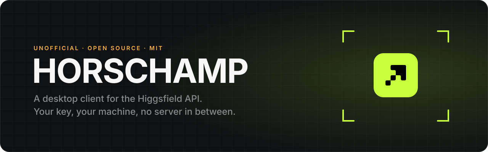

<p align="center">
  
</p>

<p align="center">
  
  
  
  
</p>

> [!IMPORTANT]
> **Horschamp is an independent, unofficial project.** It is not affiliated with, endorsed by, sponsored by or connected to Higgsfield in any way. "Higgsfield" is a trademark of its owner and is used here only to say which API this client works with. Horschamp has its own name, logo and [design system](docs/DESIGN_SYSTEM.md), and uses no Higgsfield logos, artwork, code or assets.

A Tauri 2 desktop app (macOS and Linux) for generating video and images with **your own** Higgsfield account and API key. React + TypeScript frontend, Rust backend. Free, MIT-licensed.

The name comes from _hors-champ_, French film vocabulary for what lies just outside the frame.

## Features

|              |                                                                                                                             |
| ------------ | --------------------------------------------------------------------------------------------------------------------------- |
| **Generate** | Chat-style composer, drag-drop inputs, parameters built from each model's schema, live cost estimate.                       |
| **Brief**    | A Claude "director" that asks questions, researches the docs and proposes a validated shot list you can queue in one click. |
| **Library**  | Every result saved locally, with filters, favorites, reuse, "use as input", reveal and an optional ffmpeg timeline export.  |
| **Spending** | A local cost log, sync from usage, CSV export and a confirmation before every paid job.                                     |

## Security model

- The Higgsfield key (and the optional Anthropic key) live **only in the OS keychain**
  (macOS Keychain / Linux Secret Service, via the `keyring` crate).
- The key **never reaches the webview**. All API calls go through Rust (Tauri commands). The frontend only ever sees a masked hint like `••••a1b2`.
- The key is never logged; HTTP errors are stripped of URLs, and the client's `Debug` output is redacted.
- The webview has no fs, http or shell plugins, and a strict CSP. Media loads through Tauri's asset protocol, scoped at runtime to your library folder.
- Spend safety is enforced in Rust, not just the UI: a job is refused unless you confirmed a price at least as high as the current estimate. The default threshold is **$0**, so every job asks.
- `.env`, `/outputs/`, `/library/`, databases and logs are git-ignored.

## Requirements

- Rust (stable) and Node 22+ with pnpm (`corepack enable`).
- macOS 12+, or Linux with the [Tauri prerequisites](https://v2.tauri.app/start/prerequisites/)
  (`libwebkit2gtk-4.1-dev`, `libsecret-1-dev`, …) and a running Secret Service (GNOME Keyring or KWallet).
- Optional: `ffmpeg`/`ffprobe` on your PATH for timeline export and video keyframes in Brief.
- Optional: [Claude Code](https://claude.com/claude-code), logged in, for the Brief director.

## Develop

```bash
pnpm install
```

```bash
pnpm tauri dev
```

The Vite dev server runs on port 1430. The frontend uses [Vite+](https://viteplus.dev) (`vp`), which bundles Vite, Vitest, oxlint and oxfmt:

```bash
pnpm check
```

```bash
pnpm test
```

```bash
pnpm test:rust
```

UI components are [shadcn/ui](https://ui.shadcn.com) (in `src/ui/`), rethemed with the tokens in `src/styles/tokens.css`. Open **Design System** in the sidebar to browse them.

## Build

```bash
pnpm tauri build
```

Outputs land in `src-tauri/target/release/bundle/`:

- macOS: `macos/Horschamp.app` and `dmg/Horschamp_0.1.0_*.dmg`
- Linux: `appimage/*.AppImage` and `deb/*.deb` (build on Linux)

Builds are unsigned. On macOS, right-click → Open the first time, or sign with your own Developer ID.

## API keys

1. Create an API key at Higgsfield (it has the form `KEY_ID:KEY_SECRET`).
2. Open **Settings → Higgsfield API key**, paste it and press **Save & test**. The app tests it first (a free status lookup) and only stores it if it works.
3. **Test**, **Replace** and **Delete** are on the same card. Deleting removes it from the keychain.

The Anthropic key (optional, for the director fallback) is managed the same way under **Settings → Claude director**.

## Spending

- Every job is quoted with Higgsfield's estimate endpoint before it is sent. Jobs at or above **Ask before jobs over** show a confirmation with the price.
- The local log records the estimate of each completed job; failed, NSFW-blocked and cancelled jobs are logged at $0.
- **Sync from Higgsfield usage** pulls real usage when your account has access to the usage endpoint. Set a starting balance to see an estimated remaining balance.

## Models

The model catalog is `models.json`, built from the Higgsfield docs. To refresh it:

```bash
pnpm refresh-models
```

This writes `models.refreshed.json` and prints a diff. Then use **Settings → Models & tools → Import refreshed models.json…** to load it (the app shows what changed before applying), or run `pnpm refresh-models --write` to overwrite `models.json` itself.

## The Brief director

- Uses the `claude` CLI if it is installed and logged in (`claude -p` with stream-json, one session per brief, resumed across turns). It runs with read-only tools plus web search/fetch and no shell or edit access.
- Otherwise it falls back to the Anthropic API with the key from the keychain.
- The system prompt is `prompts/director.md`, copied to your app config folder on first launch. **Settings → Claude director → Edit** opens that copy; **Reset** restores the default.
- Shot lists are validated against each model's schema; invalid shots get one automatic repair turn. Briefs are saved per project.

## Where things are stored

| What            | Where                                                        |
| --------------- | ------------------------------------------------------------ |
| Keys            | OS keychain, service `app.horschamp.desktop`                 |
| Database        | app data folder, `studio.db` (SQLite)                        |
| Media           | `~/Movies/Horschamp Library` by default (change in Settings) |
| Director prompt | app config folder, `director.md`                             |

Builds from before the rename (bundle id `app.studio.higgsfield-client`) are migrated automatically on first launch: app data, the keychain entries and an existing `~/Movies/Studio Library` are reused.

## Using the Higgsfield API

- Each person uses **their own** Higgsfield account and API key. Horschamp never ships, shares or proxies a key, and there is no server in between: the app talks to the Higgsfield API directly from your machine.
- Your use of the API stays under [Higgsfield's terms of use](https://higgsfield.ai/terms-of-use-agreement). Generations are billed to your account at Higgsfield's prices.
- Horschamp does not remove watermarks or provenance data from outputs.

## Docs

- `docs/API_NOTES.md`: how the Higgsfield API behaves (auth, submit/poll, errors, uploads).
- `docs/CLAUDE_HEADLESS_NOTES.md`: how the director drives Claude Code.
- `docs/DESIGN_SYSTEM.md`: design tokens and components.

## License

[MIT](LICENSE) © 2026 bentocoding
